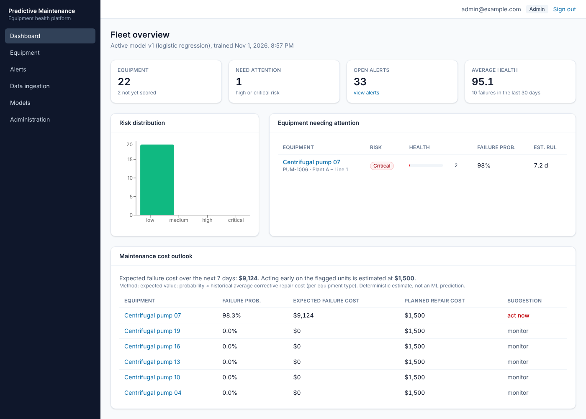
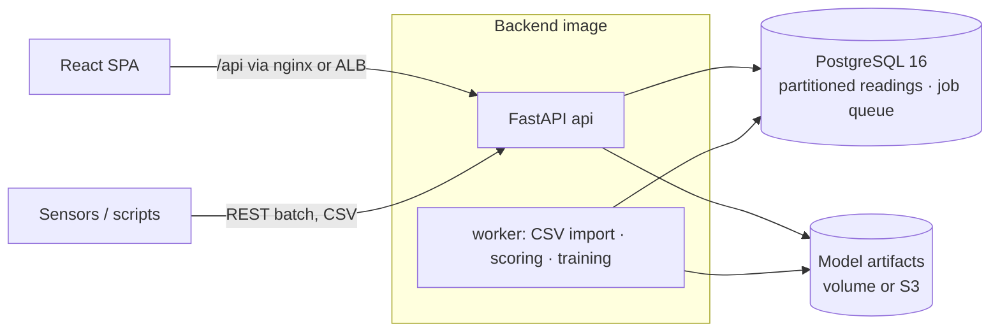

# AI Predictive Maintenance Platform

Predicts industrial equipment failures from sensor data, explains every prediction, and recommends maintenance before a breakdown happens.

## The problem

Unplanned equipment failure is one of the most expensive events in manufacturing, energy and utilities:
production stops, emergency repairs cost far more than planned work, and some failures are dangerous. Most
sites either repair machines after they break, or service them on a fixed calendar, which replaces healthy
parts and still misses failures that develop between visits.

## What this platform does

- Collects sensor readings (vibration, temperature, current, pressure, flow) from pumps, compressors and motors through an API or CSV upload.
- Estimates each machine's probability of failing in the next 7 days, a 0–100 health score and its remaining useful life.
- Explains **why** in plain language ("vibration has been rising steadily for three days"), so engineers can trust the prediction and act on it.
- Raises alerts when risk climbs and recommends a maintenance action, so work is scheduled **before** the breakdown instead of after it.

**Who it is for:** maintenance engineers and reliability teams deciding which machine to service first.

**Stack:** Python 3.13 · FastAPI · PostgreSQL 16 · scikit-learn · XGBoost · SHAP · React 18 + TypeScript · Tailwind · Docker · Terraform (AWS ECS Fargate + RDS) · GitHub Actions



> **Data notice.** All data is synthetic, generated by a documented physics-inspired simulator ([`backend/app/ml/synthetic.py`](backend/app/ml/synthetic.py)). The model metrics below show how well the models learn the simulator's patterns. They are **not** evidence of real-world performance.

## What it does

| Area | Capabilities |
|---|---|
| **Equipment** | Register pumps, compressors and motors with manufacturer, model, install date, location and operating conditions; per-type sensor definitions with valid ranges |
| **Ingestion** | Batched REST API and CSV upload (streamed, size-limited, validated row by row, imported by a background worker with PostgreSQL `COPY`); duplicates skipped and reported |
| **Prediction** | Probability of failure within 7 days, health score (0–100), risk level (low / medium / high / critical, admin-configurable thresholds), remaining-useful-life estimate, anomaly score |
| **Explainability** | Exact SHAP values for every prediction, **grouped by sensor** and turned into plain sentences ("Discharge pressure is 4.5σ below this unit's normal level") |
| **Recommendations** | Deterministic engineering rules, clearly labelled as rule-based rather than AI: inferred failure mode → action → urgency |
| **Alerts** | Raised automatically when risk increases; acknowledge / resolve workflow |
| **Analytics** | Fleet dashboard, sensor trends with server-side downsampling, risk history, side-by-side equipment comparison (MTBF, cost), maintenance-cost outlook, CSV reports |
| **What-if simulator** | Inject a simulated bearing wear / seal leak / winding fault into a unit's real recent data and see how the model reacts |
| **MLOps-lite** | Model registry with versioning, integrity-checked artifacts (SHA-256), evaluation report per version, one-click activation and rollback |
| **Security** | argon2id passwords, 15-min JWT + rotating httpOnly refresh cookie with reuse detection, role-based access (viewer / engineer / admin), login rate limit + lockout, audit log, CSV formula-injection guard |

## Architecture



One codebase deployed as two processes (API and worker), with PostgreSQL as both the database and the job queue (`SELECT … FOR UPDATE SKIP LOCKED`). Sensor readings live in a narrow table range-partitioned by month. The reasoning, alternatives and trade-offs are in [`docs/DESIGN.md`](docs/DESIGN.md).

## Model results (actual, from [`ml/reports/evaluation.md`](ml/reports/evaluation.md))

40 synthetic units × 365 days, 56,802 observations, 5.0 % positive. Evaluated two ways, in both cases leakage-safe: grouped 5-fold cross-validation (no unit appears in both train and test) and a later-time holdout (trained only on the past).

| Model | CV PR-AUC | Holdout PR-AUC | Holdout ROC-AUC |
|---|---|---|---|
| Rule baseline (max z-score) | 0.461 ± 0.039 | 0.510 | 0.948 |
| Logistic regression | **0.800 ± 0.026** | 0.829 | 0.980 |
| Random forest | 0.786 ± 0.018 | 0.838 | 0.986 |
| XGBoost | 0.782 ± 0.025 | 0.809 | 0.983 |

A random model would score PR-AUC ≈ 0.06. The production algorithm is picked automatically by cross-validated PR-AUC. **Logistic regression won**, narrowly and within noise, so it is the default; XGBoost is fully supported. The calibrated production model flagged **34 of 35** holdout failures at "high" risk, with a median of **6.6 days'** warning, at a precision of 0.83.

Honest caveats (details in [`docs/known-limitations.md`](docs/known-limitations.md)):
- Mid-range probabilities are under-confident. For example, a predicted 38 % corresponds to a 66 % observed failure rate.
- The remaining-useful-life model is only modestly better than always predicting the median (MAE 10.8 vs 14.8 days).
- A smaller demo fleet (20 units × 180 days) gives a much weaker model (holdout PR-AUC ≈ 0.51).

## Quick start (Docker)

```bash
cp .env.example .env
```

Edit `.env` and replace every `CHANGE_ME` value. Then:

```bash
docker compose up -d --build
```

```bash
docker compose run --rm api python -m app.cli demo --admin-email admin@example.com
```

The `demo` command creates an admin user (password = `PDM_ADMIN_PASSWORD` from `.env`), generates and loads a 40-unit × 365-day synthetic fleet (~4.4 M readings), trains and evaluates all models, activates the best one, and replays it over the last 30 days. It takes about 5 minutes. Then open <http://localhost:8080>.

API docs (Swagger UI): <http://localhost:8000/api/docs> · static spec: [`docs/openapi.json`](docs/openapi.json).

To try a CSV import, upload [`data/sample/sample_readings.csv`](data/sample/sample_readings.csv) on the **Data ingestion** page.

## Development

See [`docs/DEVELOPMENT.md`](docs/DEVELOPMENT.md) for running without Docker, the test setup and the CLI. In short:

```bash
make lint
```

```bash
make test
```

```bash
make smoke E2E_PASSWORD=...
```

| Check | Result at the latest commit (run locally) |
|---|---|
| Backend tests (pytest, real PostgreSQL) | 124 passed, 90 % line coverage |
| Frontend tests (Vitest + Testing Library) | 13 passed |
| Browser smoke test (Playwright vs. docker compose) | passed |
| ruff · mypy · ESLint · `tsc --strict` | clean |
| Single-client performance (`e2e/perf_check.py`) | 13.4k readings/s ingestion; predict p95 242 ms |
| Terraform `fmt`/`validate` | runs in CI only (not run locally; see limitations) |

## Repository layout

```
backend/            FastAPI app, worker, ML pipeline, Alembic migrations, tests
  app/core/         config, logging, security, errors
  app/modules/      auth, users, equipment, ingestion, readings, predictions, alerts, maintenance, models, …
  app/ml/           synthetic data, features, dataset, training/evaluation, scoring, SHAP explanations, registry
  app/jobs/         PostgreSQL job queue and worker
frontend/           React + TypeScript SPA, nginx config
infra/terraform/    AWS: VPC, RDS, S3, ECS Fargate, ALB, IAM, alarms, budget, GitHub OIDC deploy role
ml/reports/         generated model evaluation report
e2e/                browser smoke test
docs/               design, development, operations, AWS deployment, model card, learning guide
```

## Documentation

- [Design document](docs/DESIGN.md): requirements, architecture decisions, data model, API, ML strategy, security
- [Model card](docs/MODEL_CARD.md): what the model does, how it was evaluated, when not to trust it
- [Operations runbook](docs/OPERATIONS.md): training, model rollback, backups, troubleshooting
- [AWS deployment](docs/AWS_DEPLOYMENT.md): architecture, **cost estimate**, deploy, rollback, **teardown**
- [Known limitations](docs/known-limitations.md)
- [Learning guide](docs/LEARNING_GUIDE.md): a walkthrough of the code with exercises
