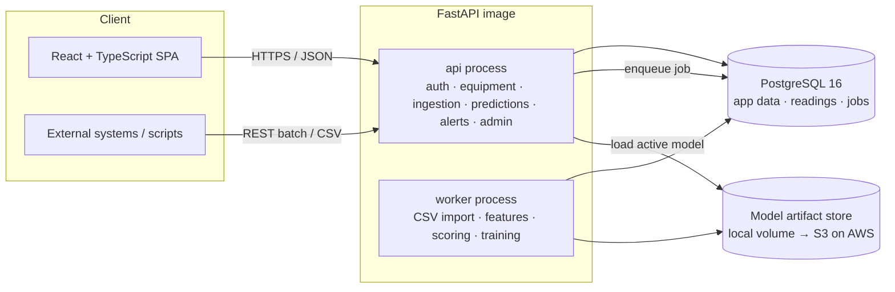
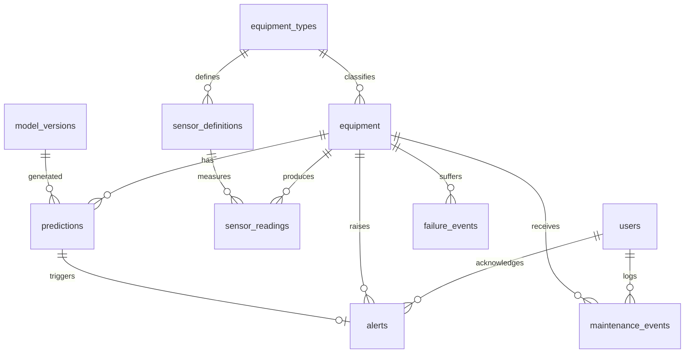

# AI Predictive Maintenance Platform — Design Document (v1.0)

Status: **Approved by the owner on 2026-11-01 and implemented.** Section 9 lists where the implementation deviates from this design, and why.

Contents
1. Product requirements
2. Architecture
3. Database design
4. API specification
5. Machine-learning strategy
6. Security design
7. Implementation roadmap
8. Decisions that need your approval

---

## 1. Product requirements

### 1.1 Problem
Unplanned equipment failure is expensive: lost production, emergency repairs, safety risk. Most plants either repair after failure (reactive) or on a fixed calendar (preventive, often wasteful). This platform estimates failure risk from sensor data so maintenance can be scheduled *before* a likely failure, and explains why.

### 1.2 Users and roles
| Role | Can do |
|---|---|
| **Admin** | Everything: manage users, roles, equipment types, risk thresholds, retrain/activate models |
| **Engineer** | Register/edit equipment, ingest data, view predictions, acknowledge alerts, log maintenance |
| **Viewer** | Read-only dashboards and reports |

### 1.3 Functional requirements (MVP)
| ID | Requirement |
|---|---|
| F1 | Email + password login, JWT sessions, role-based access (admin / engineer / viewer) |
| F2 | Equipment CRUD: name, type, manufacturer, model, serial, install date, location, operating conditions |
| F3 | Sensor definitions per equipment type (name, unit, expected range) |
| F4 | Sensor ingestion via REST (batched JSON) and CSV upload, with row-level validation report |
| F5 | Historical readings stored in PostgreSQL; queryable by equipment, sensor, time range, with downsampling |
| F6 | Failure-probability prediction (probability of failure within next *H* days, default H = 7) |
| F7 | Health score 0–100 per equipment |
| F8 | Risk class: low / medium / high / critical (thresholds configurable by admin) |
| F9 | Per-prediction explanation: top contributing features (SHAP) in plain language |
| F10 | Maintenance recommendations (rule-based, driven by risk class + top contributing failure mode) |
| F11 | Alerts when risk class increases; acknowledge / resolve workflow |
| F12 | Maintenance log (what was done, when, cost) — also feeds back as training labels |
| F13 | Dashboard: fleet overview, equipment detail with sensor trends, alerts, maintenance history |
| F14 | Admin: users, thresholds, model registry (view metrics, activate a model version) |

### 1.4 Advanced requirements (post-MVP, in priority order)
A1 Remaining useful life (RUL) estimate · A2 Anomaly detection on sensor patterns · A3 Equipment comparison ·
A4 Maintenance report export (PDF/CSV) · A5 Maintenance cost forecast · A6 Failure scenario simulator.

### 1.5 Non-functional requirements
- Reproducible: `docker compose up` brings up the full stack with demo data.
- Ingest ≥ 5,000 readings/second on a laptop for batch imports (to be measured, not assumed).
- Prediction for one equipment < 300 ms p95 (to be measured).
- All APIs documented via OpenAPI (FastAPI generates it; we add examples).
- Structured JSON logs with request IDs.
- 12-factor configuration so the same images run locally and on AWS.

### 1.6 Out of scope (explicitly)
Real-time streaming from PLC/OPC-UA/MQTT (designed for, not built in MVP), multi-tenancy, mobile app, real customer data.

---

## 2. Architecture

### 2.1 Decision: modular monolith + one background worker (not microservices)
**Recommendation:** a single FastAPI codebase organised into clear modules, deployed as two processes from the same image — `api` (serves HTTP) and `worker` (CSV imports, feature computation, batch scoring, model training).

| Option | Pros | Cons |
|---|---|---|
| **Modular monolith + worker (recommended)** | Simple to run, debug and understand; one DB transaction boundary; easy to split later because module boundaries are enforced | Must stay disciplined about module boundaries |
| Microservices (ingestion / ML / alerts) | Independent scaling, looks "enterprise" | Network calls, distributed failure modes, much more infra — complexity without a real scaling need at this size. Project 9 is where distributed systems are showcased |

### 2.2 Decision: job queue in PostgreSQL (not Redis/Celery) for MVP
Jobs are rows in a `jobs` table, claimed with `SELECT … FOR UPDATE SKIP LOCKED`. One less service to run, jobs are transactional with the data they touch, and status is queryable for the UI. Throughput (hundreds of jobs/minute) is far above what this app needs. If it is outgrown, swap the queue adapter for SQS on AWS.

### 2.3 Component diagram


### 2.4 Backend module layout
```
backend/app/
  core/          config (pydantic-settings), logging, security (hashing, JWT), errors
  db/            SQLAlchemy 2.0 models, session, Alembic migrations
  modules/
    auth/        login, refresh, current user, role guards
    users/       admin user management
    equipment/   equipment types, equipment, sensor definitions
    ingestion/   REST batch + CSV upload → validation → bulk insert (COPY)
    readings/    time-range queries, downsampling
    features/    feature engineering (shared by training and inference — one code path)
    ml/          training pipeline, evaluation, model registry, explainers
    predictions/ scoring, health score, risk classification, explanations
    recommendations/ rule engine mapping risk + failure mode → actions
    alerts/      alert generation on risk change, ack/resolve
    maintenance/ maintenance log
    jobs/        queue adapter, worker loop
  main.py        app factory, router registration, middleware
ml/              synthetic data generator, offline experiments, evaluation reports
frontend/        Vite + React + TypeScript + TanStack Query + Recharts + Tailwind
```
Each module exposes `router.py` (HTTP), `service.py` (business logic), `schemas.py` (Pydantic), `repository.py` (DB access). Routers never touch the DB directly — this keeps logic testable and modules separable.

### 2.5 Prediction data flow
```mermaid
sequenceDiagram
  participant S as Sensor source
  participant API
  participant DB as PostgreSQL
  participant W as Worker
  S->>API: POST /readings:batch (or CSV upload)
  API->>API: validate (schema, ranges, known sensors)
  API->>DB: COPY readings; insert job(score_equipment)
  API-->>S: 202 Accepted + ingestion report
  W->>DB: claim job (SKIP LOCKED)
  W->>DB: load last N days of readings
  W->>W: features → active model → probability, SHAP, health, risk
  W->>DB: insert prediction; if risk ↑ insert alert
```

### 2.6 Key library choices
| Concern | Choice | Why |
|---|---|---|
| Web | FastAPI + Uvicorn | Async, typed, OpenAPI for free |
| ORM / migrations | SQLAlchemy 2.0 + Alembic | Industry standard, explicit SQL when needed |
| Validation | Pydantic v2 | Shared with FastAPI |
| Passwords | argon2 (`argon2-cffi`) | Current OWASP recommendation |
| ML | scikit-learn, XGBoost, SHAP | As specified; SHAP TreeExplainer is exact & fast for trees |
| Frontend | Vite, React 18, TypeScript strict, TanStack Query, React Router, Recharts, Tailwind | Lightweight, well documented |
| Tests | pytest + httpx + testcontainers (Postgres); Vitest + Testing Library; Playwright for a few E2E flows | Real DB in integration tests, not mocks |
| Quality | ruff, mypy, ESLint, Prettier, pre-commit; GitHub Actions CI | |

---

## 3. Database design

### 3.1 ER diagram


### 3.2 Tables (abridged; full DDL in Alembic migrations)
| Table | Key columns | Notes |
|---|---|---|
| `users` | id UUID PK, email UNIQUE, password_hash, role ENUM(admin,engineer,viewer), is_active, created_at | |
| `refresh_tokens` | id, user_id FK, token_hash, expires_at, revoked_at | Stored hashed; supports logout/rotation |
| `equipment_types` | id, code UNIQUE (`pump`, `compressor`, `motor`), name, description | |
| `sensor_definitions` | id, equipment_type_id FK, code, unit, min_valid, max_valid | UNIQUE(equipment_type_id, code) |
| `equipment` | id UUID, equipment_type_id, name, serial UNIQUE, manufacturer, model, install_date, location, operating_conditions JSONB, status ENUM(active,maintenance,retired), created_at, updated_at | JSONB for type-specific conditions (rated load, duty cycle) |
| `sensor_readings` | equipment_id, sensor_id, ts TIMESTAMPTZ, value DOUBLE PRECISION | **PK (equipment_id, sensor_id, ts)**; range-partitioned by month on `ts`; BRIN index on `ts` |
| `failure_events` | id, equipment_id, occurred_at, failure_mode, description | Ground-truth labels for training |
| `maintenance_events` | id, equipment_id, performed_at, type ENUM(inspection,repair,replacement,preventive), notes, cost NUMERIC(12,2), user_id | |
| `model_versions` | id, name, version, algorithm, horizon_days, feature_list JSONB, metrics JSONB, artifact_uri, trained_at, data_snapshot JSONB, is_active | Partial unique index: only one active model per name |
| `predictions` | id, equipment_id, model_version_id, as_of TIMESTAMPTZ, failure_probability, health_score, risk_level, rul_days NULL, explanation JSONB, created_at | Index (equipment_id, as_of DESC) |
| `alerts` | id, equipment_id, prediction_id, previous_risk, new_risk, status ENUM(open,acknowledged,resolved), acknowledged_by, created_at, resolved_at | |
| `risk_thresholds` | risk_level PK, min_probability | Admin-configurable |
| `ingestion_batches` | id, source ENUM(api,csv), filename, rows_total, rows_accepted, rows_rejected, errors JSONB (first 100), user_id, created_at | Audit trail for imports |
| `jobs` | id, type, payload JSONB, status, attempts, max_attempts, run_after, locked_at, last_error, created_at | Queue |
| `audit_log` | id, user_id, action, entity, entity_id, details JSONB, ts | Admin actions |

### 3.3 Why this shape for readings
- **Narrow ("long") table** (one row per sensor value) rather than one column per sensor: equipment types have different sensors; adding a sensor needs no migration.
- **Monthly partitions** keep indexes small, make retention trivial (`DROP` an old partition), and let queries over recent data prune old partitions.
- **BRIN on ts** is tiny and effective because readings arrive roughly in time order.
- Ingestion uses PostgreSQL `COPY` (via psycopg 3) — typically 10–50× faster than row INSERTs. Duplicate (equipment, sensor, ts) rows are rejected via staging table + `ON CONFLICT DO NOTHING`.
- *Alternative considered:* TimescaleDB extension (hypertables, continuous aggregates). Better at very large scale, but adds an extension that is not available on plain RDS. Plain partitioning keeps the AWS path simple (RDS PostgreSQL). Can be revisited.

### 3.4 Data volume estimate (demo)
50 equipment × 6 sensors × 1 reading / 10 min × 365 days ≈ **15.8 M rows** (~1.5 GB with indexes). Comfortable on a laptop and on a small RDS instance.

---

## 4. API specification (v1)

All endpoints under `/api/v1`. JSON. Errors follow RFC 9457 problem-details: `{type, title, status, detail, errors[]}`. Lists are paginated `?limit=&cursor=`.

| Method & path | Role | Purpose |
|---|---|---|
| `POST /auth/login` | public | email+password → access token (15 min) + refresh token (httpOnly cookie, 7 days) |
| `POST /auth/refresh` · `POST /auth/logout` | auth | rotate / revoke refresh token |
| `GET /auth/me` | auth | current user |
| `GET/POST /users`, `PATCH/DELETE /users/{id}` | admin | user management |
| `GET/POST /equipment-types`, `GET/POST /equipment-types/{id}/sensors` | admin (write), all (read) | |
| `GET /equipment?type=&risk=&status=&q=` | viewer+ | list with latest prediction embedded |
| `POST /equipment` · `GET/PATCH/DELETE /equipment/{id}` | engineer+ (write) | |
| `POST /equipment/{id}/readings:batch` | engineer+ | up to 10,000 readings `[{sensor, ts, value}]` → 202 + ingestion report |
| `POST /ingestion/csv` | engineer+ | multipart CSV (`equipment_serial,sensor,ts,value`), ≤ 50 MB → 202 + batch id |
| `GET /ingestion/batches/{id}` | engineer+ | status + row-level error report |
| `GET /equipment/{id}/readings?sensor=&from=&to=&bucket=1h` | viewer+ | time series, server-side downsampled (avg/min/max per bucket) |
| `POST /equipment/{id}/predict` | engineer+ | synchronous score now → prediction |
| `GET /equipment/{id}/predictions?from=&to=` | viewer+ | prediction history |
| `GET /predictions/{id}` | viewer+ | full prediction incl. explanation & recommendations |
| `GET /alerts?status=&risk=` · `POST /alerts/{id}/acknowledge` · `POST /alerts/{id}/resolve` | viewer+ / engineer+ | |
| `GET/POST /equipment/{id}/maintenance` | viewer+ / engineer+ | maintenance log |
| `POST /equipment/{id}/failures` | engineer+ | record actual failure (label) |
| `GET /dashboard/summary` | viewer+ | fleet counts by risk, open alerts, recent failures |
| `GET /models` · `POST /models/train` · `POST /models/{id}/activate` | admin | registry, async training job, activation |
| `GET/PUT /config/risk-thresholds` | admin | |
| `GET /health/live` · `GET /health/ready` | public | liveness / readiness (DB + model loaded) |

Example prediction response:
```json
{
  "id": "9b2c…",
  "equipment_id": "41f0…",
  "as_of": "2026-11-01T12:00:00Z",
  "model": {"name": "failure-7d", "version": 3, "algorithm": "xgboost"},
  "failure_probability": 0.62,
  "health_score": 38,
  "risk_level": "high",
  "explanation": {
    "method": "shap",
    "top_factors": [
      {"feature": "vibration_rms_slope_72h", "value": 0.041, "contribution": 0.21,
       "text": "Vibration has been rising steadily over the last 3 days"},
      {"feature": "bearing_temp_max_24h", "value": 88.4, "contribution": 0.12,
       "text": "Bearing temperature peaked well above its normal range"}
    ]
  },
  "recommendations": [
    {"source": "rule", "priority": "high",
     "action": "Inspect bearings and lubrication within 72 hours"}
  ]
}
```
Note `"source": "rule"` — recommendations are deterministic rules, not AI output, and are labelled as such.

---

## 5. Machine-learning strategy

### 5.1 Synthetic data (because no real plant data is available)
A seeded, documented generator (`ml/synthetic/`) simulates a fleet of **pumps, compressors and motors**, each with 5–7 sensors (vibration RMS, bearing temperature, motor current, discharge pressure, flow, RPM, ambient temperature).

How it creates realistic signal rather than noise:
- **Baseline behaviour** per unit: manufacturer/model offsets, daily load cycle, ambient seasonality, Gaussian + occasional spike noise, sensor dropouts.
- **Degradation processes** with distinct physical signatures, each starting at a random time and progressing non-linearly until failure:
  - *Bearing wear* → vibration RMS rises exponentially, temperature follows with lag.
  - *Seal / leak* → discharge pressure and flow drift down, current rises to compensate.
  - *Electrical / winding* → current imbalance and temperature spikes.
- **Maintenance resets**: preventive maintenance partially resets degradation, so the model must use recent behaviour, not age alone.
- **Censored units**: some units never fail during the window (realistic class imbalance; target ≈ 2–5 % positive windows).
- Output: CSVs + a loader that populates the DB, plus a `README` describing every parameter.

Optional external sanity check: NASA C-MAPSS turbofan dataset (public, real-simulation benchmark) to show the pipeline works beyond our own generator. Licensing/citation will be documented.

### 5.2 Targets
- **Classification (MVP):** `y = 1` if a failure occurs within the next H = 7 days of the observation time.
- **Regression (A1):** remaining useful life in days, trained only on units that eventually fail (censoring documented as a limitation; survival models such as Cox/AFT considered later).
- **Anomaly (A2):** Isolation Forest per equipment type on healthy-period features; output an anomaly score, not a failure claim.

### 5.3 Features (computed by one shared `features` module for training *and* inference)
Per sensor over windows of 6 h / 24 h / 72 h: mean, std, min, max, last value, linear slope, z-score vs. the unit's own 30-day baseline, rate of threshold exceedance. Plus: days since last maintenance, equipment age, operating-hours proxy, equipment type (one-hot). Sharing the module avoids training/serving skew — a common real-world bug.

### 5.4 Validation (leakage-safe)
- **Split by equipment** (`GroupKFold`, 5 folds): a unit's windows never appear in both train and test — otherwise the model memorises units.
- **Plus a time-ordered holdout**: train on months 1–9, test on months 10–12, to mimic deployment.
- Hyper-parameters tuned only inside training folds.

### 5.5 Models compared
1. Rule baseline (e.g., "vibration > X") — the bar every ML model must beat.
2. Logistic regression (scaled features, class weights).
3. Random forest (class-balanced).
4. XGBoost (`scale_pos_weight`, early stopping on a validation split).
Probabilities calibrated with isotonic or Platt scaling (chosen on validation data).

### 5.6 Metrics reported (no numbers until we run them)
- **PR-AUC** (primary — appropriate for imbalanced data), ROC-AUC (secondary).
- Precision / recall / F1 at the operating threshold; **recall at precision ≥ 0.5** (maintenance teams tolerate some false alarms but not alert fatigue).
- **Brier score** + reliability plot (are probabilities trustworthy?).
- **Lead time**: median days of warning before actual failures.
- Mean ± std across folds, and the holdout result. Every number is written by `ml/evaluate.py` into `ml/reports/` with dataset seed and git commit.
- RUL: MAE and RMSE in days; anomaly: precision at top-k on labelled degradation periods.

Caveat to be stated in README: high scores on synthetic data mostly measure how learnable our own simulator is; they are not evidence of real-world performance.

### 5.7 From probability to health and risk
- `health_score = round(100 × (1 − p_calibrated))` — simple and explainable. (Option: blend with anomaly score in A2.)
- Risk class from admin-configurable thresholds, defaults: low < 0.10 ≤ medium < 0.30 ≤ high < 0.60 ≤ critical. Defaults are chosen from the precision/recall curve during evaluation and documented.

### 5.8 Explainability
SHAP TreeExplainer for XGBoost/RF (exact, milliseconds per row). Top 3–5 contributions stored in `predictions.explanation`; a template maps feature names to human sentences. Global feature importance shown on the model page.

### 5.9 Model registry & lifecycle
Training job → artifacts (`model.joblib`, `calibrator.joblib`, `features.json`, `metrics.json`) saved to the artifact store → row in `model_versions` → admin reviews metrics → activates. The API loads the active model at startup and on activation. MLflow is intentionally deferred to Project 8 (AWS MLOps) to avoid duplicating that showcase; the registry interface is designed so MLflow can replace it.

---

## 6. Security design
- **AuthN:** argon2id password hashing; short-lived JWT access tokens (15 min, HS256 key from env); refresh tokens rotated, stored hashed, httpOnly + Secure + SameSite=strict cookie.
- **AuthZ:** role dependency on each route (`require_role("engineer")`); tested with a role × endpoint matrix test.
- **Input validation:** Pydantic schemas; CSV uploads checked for size (≤ 50 MB), MIME/extension, header schema, row-level types and sensor ranges; files streamed, never executed or stored with user-supplied names.
- **Login protection:** rate limit on `/auth/login` (slowapi), generic error messages, account lockout after repeated failures.
- **Transport/headers:** CORS restricted to frontend origin; security headers (HSTS behind TLS, X-Content-Type-Options, CSP on the SPA).
- **DB:** app connects as a non-superuser role; migrations run with a separate role.
- **Secrets:** env vars locally; AWS Secrets Manager later. `.env` git-ignored; gitleaks in CI.
- **Model artifacts:** only loaded from the trusted artifact store (joblib/pickle is unsafe for untrusted input — users cannot upload models).
- **Audit:** admin actions, model activation, threshold changes written to `audit_log`.

---

## 7. Implementation roadmap

Each milestone ends with: passing tests (output shown), docs updated, a walkthrough for you, and your sign-off.

| # | Milestone | Deliverables |
|---|---|---|
| M0 | Repo foundation | Monorepo layout, Docker Compose (Postgres, api, worker, web), pre-commit, CI (lint, type-check, tests), `.env.example` |
| M1 | Core + Auth | Config, logging, error handling, DB session, Alembic, users, login/refresh/logout, role guards, tests |
| M2 | Equipment | Types, sensor definitions, equipment CRUD, seed data, tests |
| M3 | Synthetic data | Generator + documentation + DB loader; data exploration notebook |
| M4 | Ingestion & readings | Batch REST, CSV upload via job queue, COPY bulk insert, downsampled queries, performance measurement |
| M5 | ML pipeline | Features module, baselines, LR/RF/XGBoost, calibration, leakage-safe evaluation report with **actual** results |
| M6 | Predictions | Scoring service, health/risk, SHAP explanations, recommendations rules, model registry & activation |
| M7 | Alerts & maintenance | Risk-change alerts, ack/resolve, maintenance & failure logs |
| M8 | Frontend | Login, fleet dashboard, equipment detail (trends, prediction, explanation), alerts, maintenance, admin |
| M9 | Hardening | E2E tests (Playwright), load test (Locust), security review, known-limitations doc |
| M10 | AWS readiness | Terraform plan for ECS Fargate + RDS + S3 + ALB, cost estimate, teardown — **design only; nothing deployed without approval** |
| M11 | Advanced | RUL, anomaly detection, comparison, reports, cost forecast, simulator |

---

## 8. Decisions that need your approval
1. **Modular monolith + worker** instead of microservices (§2.1).
2. **PostgreSQL job queue** instead of Redis/Celery for MVP (§2.2).
3. **Plain PostgreSQL with monthly partitions** instead of TimescaleDB (§3.3).
4. **Prediction target:** failure within **7 days** (H configurable).
5. **Synthetic fleet** of pumps / compressors / motors (§5.1), optionally plus NASA C-MAPSS as an external check.
6. **MLflow deferred to Project 8**; lightweight in-app model registry here (§5.9).
7. **Frontend stack:** Vite + React + TypeScript + TanStack Query + Recharts + Tailwind (vs. Next.js — not needed for an authenticated internal dashboard).

---

## 9. Changes made during implementation

| Area | Original design | What was built | Why |
|---|---|---|---|
| Production model | XGBoost | Algorithm chosen automatically by cross-validated PR-AUC; **logistic regression won** (0.800 vs 0.782 for XGBoost, within noise). Both are supported | Follow the evidence, not the plan |
| Temperature features | Raw sensor values | Temperature **rise above ambient**; ambient is not a model input | The first evaluation showed XGBoost ranking ambient temperature as a top feature. That's a spurious seasonal signal, and it hurt the time-holdout score (0.728 → 0.809 after the fix) |
| Explanations | Top individual SHAP features | **Grouped SHAP**: contributions summed per sensor | Correlated features got large offsetting contributions ("high temperature lowers risk"), which reads as nonsense to an engineer |
| SHAP implementation | `shap` library | XGBoost `pred_contribs` (TreeSHAP) and the exact linear formula for LR; the `shap` library is used in tests to verify | Faster, no heavy runtime dependency, identical values (tested) |
| History backfill | — | `backfill` command replays the active model over the past 30 days | Gives the demo a real risk trend and alert history, produced by the model rather than invented |
| Upload hand-off | Local file | Local volume in Compose; **S3** on AWS | On ECS the API and worker are separate tasks with separate disks |
| XGBoost package | `xgboost` | `xgboost-cpu` | Same API; the image shrank from 1.65 GB to 863 MB |
| Repository layer | `repository.py` per module | Services query SQLAlchemy directly; trivial modules have only a router | Extra layer added no value at this size |
| Advanced features | M11 roadmap | RUL, anomaly score, comparison, CSV reports, cost outlook and what-if simulator all built | Owner asked for everything |
